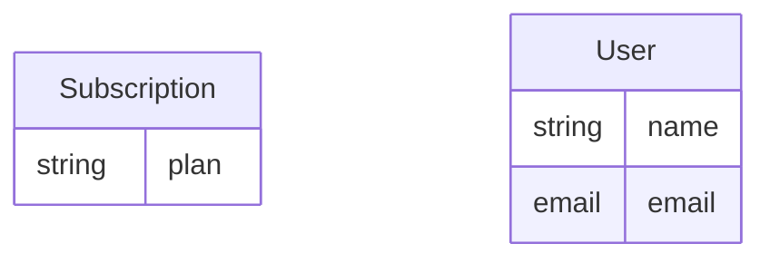

# Data

2 entities, how they relate, and who reads, writes and shows them. Fields, types and examples are in [the domain model](back/domain.md); lifecycles in [logic](LOGIC.md).

## Subscription

| | |
|---|---|
| Fields | `plan`? ([details](back/domain.md#entity-subscription)) |
| Relations | — |
| Written by | — |
| Read by | [Sign up](FUNCTIONS.md#fn-sign-up) |
| Shown on | [Profile](front/screens/scr-profile.md) |
| Operations | — |

## User

| | |
|---|---|
| Fields | `name`?, `email`? ([details](back/domain.md#entity-user)) |
| Relations | — |
| Written by | [Sign up](FUNCTIONS.md#fn-sign-up) |
| Read by | [Sign up](FUNCTIONS.md#fn-sign-up) |
| Shown on | [Profile](front/screens/scr-profile.md) |
| Operations | [`POST /users`](back/api.md#op-create-account-10) · [`GET /users/me`](back/api.md#op-get-users-me-3) · [`PATCH /users/me`](back/api.md#op-patch-users-me-15) |

## Notes

<!-- weshcraft:notes:start -->
_Ownership, retention, privacy (personal data), volumes, indexes, migrations._
<!-- weshcraft:notes:end -->

<!-- weshcraft:contract
{
 "entities": [
  {
   "fields": [
    "plan"
   ],
   "name": "Subscription",
   "readBy": [
    "fn-sign-up"
   ],
   "relations": [],
   "shownOn": [
    "scr-profile"
   ],
   "writtenBy": []
  },
  {
   "fields": [
    "name",
    "email"
   ],
   "name": "User",
   "readBy": [
    "fn-sign-up"
   ],
   "relations": [],
   "shownOn": [
    "scr-profile"
   ],
   "writtenBy": [
    "fn-sign-up"
   ]
  }
 ],
 "kind": "data",
 "sourceHash": "67b6d208abc608b7"
}
-->
