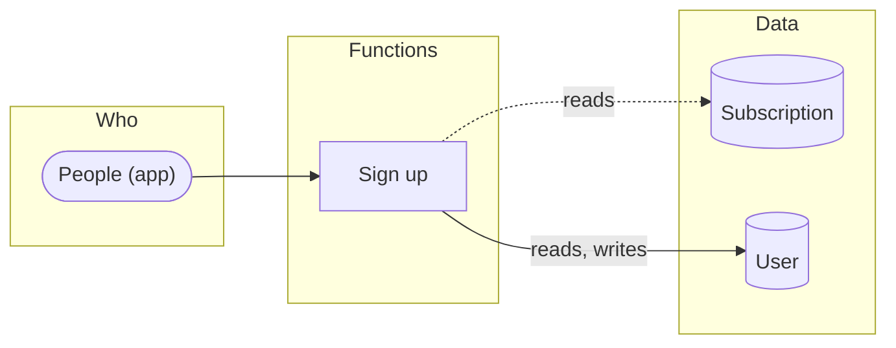

# How the product works

1 function: [Sign up](#fn-sign-up). Who uses each one, the data it reads and writes, and where it leads. The screen, API and map specs refer to these functions.

**Suggested.** These functions are grouped from the prototype (flows, sections, navigation, API tags). Name them and give each a purpose (`design_functions`, or the Functions view) to make them the product's.

Legend: ⇒ leads to (the user moves on to) · → writes · ⇢ reads.

## Sign up

_Purpose not described yet._

| | |
|---|---|
| Who | People (app) |
| Screens | [Sign up](front/screens/scr-sign-up.md) → [Profile](front/screens/scr-profile.md) |
| Operations | [`POST /users`](back/api.md#op-create-account-10) · [`GET /users/me`](back/api.md#op-get-users-me-3) · [`PATCH /users/me`](back/api.md#op-patch-users-me-15) |
| Data | [Subscription](back/domain.md#entity-subscription) (reads) · [User](back/domain.md#entity-user) (reads, writes) |
| Leads to | — |
| Code | tag `@weshcraft fn-sign-up` · [what implements it](TRACE.md) |

## Notes

<!-- weshcraft:notes:start -->
_Product notes: goals, what is out of scope, open questions._
<!-- weshcraft:notes:end -->

<!-- weshcraft:contract
{
 "declared": false,
 "functions": [
  {
   "entities": [
    {
     "access": "reads",
     "name": "Subscription"
    },
    {
     "access": "reads, writes",
     "name": "User"
    }
   ],
   "key": "fn-sign-up",
   "name": "Sign up",
   "next": [],
   "operations": [
    "op-create-account-10",
    "op-get-users-me-3",
    "op-patch-users-me-15"
   ],
   "screens": [
    "scr-sign-up",
    "scr-profile"
   ],
   "summary": "",
   "tools": []
  }
 ],
 "kind": "functions",
 "sourceHash": "67b6d208abc608b7",
 "unassigned": {
  "operations": [],
  "screens": [],
  "tools": []
 }
}
-->
