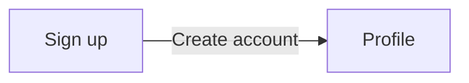

# Navigation and flows

| From | Element | To | Transition |
|---|---|---|---|
| Sign up | `#10` Create account | Profile | dissolve |

## Notes

<!-- weshcraft:notes:start -->
_No notes yet. Agent or human additions go here; WeshCraft keeps this block when it regenerates the file._
<!-- weshcraft:notes:end -->

<!-- weshcraft:contract
{
 "edges": [
  {
   "from": "scr-sign-up",
   "node": 10,
   "to": "scr-profile"
  }
 ],
 "kind": "front-flows",
 "sourceHash": "5a5d8a8b3efe1d09"
}
-->
