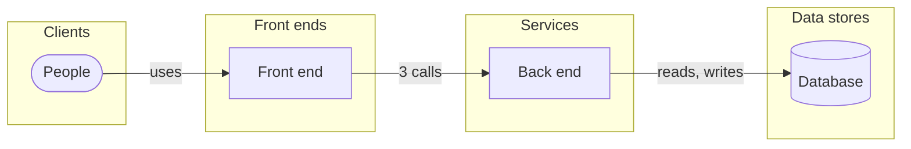

# Architecture

4 components and how they talk. Suggested from the design, the API and the MCP surface: declare the real one (the Architecture view, or `weshcraft_edit` {op:"component"} / {op:"connect"}) with its technologies.

| Component | Kind | Technology | Implements | Code |
|---|---|---|---|---|
| **People** Use the app | client | — | — | — |
| **Front end** The app people use | frontend | — | [Sign up](front/screens/scr-sign-up.md) · [Profile](front/screens/scr-profile.md) | — |
| **Back end** Runs the operations and the rules | service | — | [`POST /users`](back/api.md#op-create-account-10) · [`GET /users/me`](back/api.md#op-get-users-me-3) · [`PATCH /users/me`](back/api.md#op-patch-users-me-15) | — |
| **Database** Holds the data | store | — | [Subscription](back/domain.md#entity-subscription) · [User](back/domain.md#entity-user) | — |

| From | To | How |
|---|---|---|
| People | Front end | uses |
| Front end | Back end | 3 calls |
| Back end | Database | reads, writes |

## Notes

<!-- weshcraft:notes:start -->
_Decisions and their reasons (ADRs), deployment, environments, scaling, security boundaries._
<!-- weshcraft:notes:end -->

<!-- weshcraft:contract
{
 "components": [
  {
   "implements": [],
   "key": "arc-people",
   "kind": "client",
   "name": "People",
   "tech": ""
  },
  {
   "implements": [
    "scr-sign-up",
    "scr-profile"
   ],
   "key": "arc-front-end",
   "kind": "frontend",
   "name": "Front end",
   "tech": ""
  },
  {
   "implements": [
    "op-create-account-10",
    "op-get-users-me-3",
    "op-patch-users-me-15"
   ],
   "key": "arc-back-end",
   "kind": "service",
   "name": "Back end",
   "tech": ""
  },
  {
   "implements": [
    "entity:Subscription",
    "entity:User"
   ],
   "key": "arc-database",
   "kind": "store",
   "name": "Database",
   "tech": ""
  }
 ],
 "declared": false,
 "kind": "architecture",
 "links": [
  {
   "from": "arc-people",
   "label": "uses",
   "to": "arc-front-end"
  },
  {
   "from": "arc-front-end",
   "label": "3 calls",
   "to": "arc-back-end"
  },
  {
   "from": "arc-back-end",
   "label": "reads, writes",
   "to": "arc-database"
  }
 ],
 "sourceHash": "e868cb3c8b18019b"
}
-->
