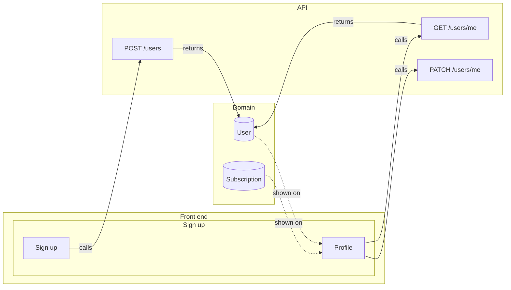

# Front ⇄ back links

Every place where the prototype meets the back end: 4 operation links and 3 data links across 2 screens. **1 gap** (below).

Legend: ▶ triggers an operation · ⇢ submits a request field · ☰ list filled by an operation · ◉ shows an entity field · ⚙ MCP tool calls it · ↗ public endpoint.

## Map

## Operations → front end

### [`POST /users`](back/api.md#op-create-account-10) — Create account

Screen: [Sign up](front/screens/scr-sign-up.md) · annotated · explicit · returns [`User`](back/domain.md#entity-user)

| Link | Layer | Element |
|---|---|---|
| ▶ triggers | `#10` | Create account |
| ⇢ submits | `#6` | Email field |
| ⇢ submits | `#8` | Password field |

### [`GET /users/me`](back/api.md#op-get-users-me-3) — GET /users/me → User

Screen: [Profile](front/screens/scr-profile.md) · annotated · explicit · returns [`User`](back/domain.md#entity-user)

| Link | Layer | Element |
|---|---|---|
| ◉ response `User.name` shown | `#12` | {{user.name}} |
| ◉ response `User.email` shown | `#13` | {{user.email:email}} |
| — | — | not reached from any layer |

### [`PATCH /users/me`](back/api.md#op-patch-users-me-15) — PATCH /users/me

Screen: [Profile](front/screens/scr-profile.md) · annotated · explicit

| Link | Layer | Element |
|---|---|---|
| ▶ triggers | `#15` | Save |

## Domain → front end

### [Subscription](back/domain.md#entity-subscription)

| Field | Shown by | Screens | Loaded by |
|---|---|---|---|
| `plan` | `#14` | [Profile](front/screens/scr-profile.md) | ⚠️ nothing |

### [User](back/domain.md#entity-user)

| Field | Shown by | Screens | Loaded by |
|---|---|---|---|
| `name` | `#12` | [Profile](front/screens/scr-profile.md) | [`GET /users/me`](back/api.md#op-get-users-me-3) |
| `email` | `#13` | [Profile](front/screens/scr-profile.md) | [`GET /users/me`](back/api.md#op-get-users-me-3) |

## Gaps

- ⚠️ `#14` on [Profile](front/screens/scr-profile.md): Subscription.plan is shown on scr-profile but no operation on that screen loads Subscription.

## Notes

<!-- weshcraft:notes:start -->
_No notes yet._
<!-- weshcraft:notes:end -->

<!-- weshcraft:contract
{
 "edges": [
  {
   "node": 10,
   "op": "op-create-account-10",
   "rel": "triggers"
  },
  {
   "node": 6,
   "op": "op-create-account-10",
   "rel": "submits"
  },
  {
   "node": 8,
   "op": "op-create-account-10",
   "rel": "submits"
  },
  {
   "node": 15,
   "op": "op-patch-users-me-15",
   "rel": "triggers"
  },
  {
   "field": "Subscription.plan",
   "node": 14,
   "rel": "displays"
  },
  {
   "field": "User.name",
   "node": 12,
   "rel": "displays"
  },
  {
   "field": "User.email",
   "node": 13,
   "rel": "displays"
  }
 ],
 "gaps": 1,
 "kind": "links",
 "sourceHash": "e868cb3c8b18019b"
}
-->
