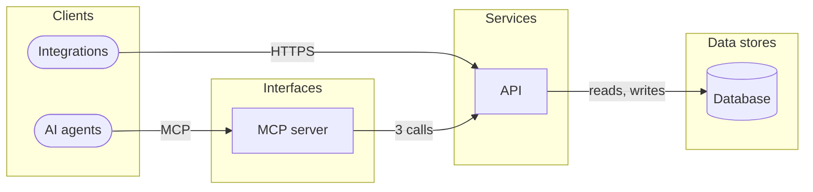

# Architecture

5 components and how they talk. Suggested from the design, the API and the MCP surface: declare the real one (`design_architecture`, or the Architecture view) with its technologies.

| Component | Kind | Technology | Implements | Code |
|---|---|---|---|---|
| **AI agents** Call the MCP tools | client | — | — | — |
| **Integrations** Call the public API | client | — | — | — |
| **MCP server** Exposes the product to AI agents | interface | — | [`create_invoice`](front/mcp/tool-create-invoice.md) · [`list_invoices`](front/mcp/tool-list-invoices.md) · [`send_invoice`](front/mcp/tool-send-invoice.md) · [`void_invoice`](front/mcp/tool-void-invoice.md) | — |
| **API** Runs the operations and the rules | service | — | [`GET /invoices`](back/api.md#op-ep-get-invoices) · [`POST /invoices`](back/api.md#op-ep-post-invoices) · [`GET /invoices/{id}`](back/api.md#op-ep-get-invoices-id) · [`POST /invoices/{id}/send`](back/api.md#op-ep-post-invoices-id-send) · [`GET /customers`](back/api.md#op-ep-get-customers) | — |
| **Database** Holds the data | store | — | [Customer](back/domain.md#entity-customer) · [Invoice](back/domain.md#entity-invoice) | — |

| From | To | How |
|---|---|---|
| AI agents | MCP server | MCP |
| Integrations | API | HTTPS |
| MCP server | API | 3 calls |
| API | Database | reads, writes |

## Notes

<!-- weshcraft:notes:start -->
_Decisions and their reasons (ADRs), deployment, environments, scaling, security boundaries._
<!-- weshcraft:notes:end -->

<!-- weshcraft:contract
{
 "components": [
  {
   "implements": [],
   "key": "arc-ai-agents",
   "kind": "client",
   "name": "AI agents",
   "tech": ""
  },
  {
   "implements": [],
   "key": "arc-integrations",
   "kind": "client",
   "name": "Integrations",
   "tech": ""
  },
  {
   "implements": [
    "tool:create_invoice",
    "tool:list_invoices",
    "tool:send_invoice",
    "tool:void_invoice"
   ],
   "key": "arc-mcp-server",
   "kind": "interface",
   "name": "MCP server",
   "tech": ""
  },
  {
   "implements": [
    "op-ep-get-invoices",
    "op-ep-post-invoices",
    "op-ep-get-invoices-id",
    "op-ep-post-invoices-id-send",
    "op-ep-get-customers"
   ],
   "key": "arc-api",
   "kind": "service",
   "name": "API",
   "tech": ""
  },
  {
   "implements": [
    "entity:Customer",
    "entity:Invoice"
   ],
   "key": "arc-database",
   "kind": "store",
   "name": "Database",
   "tech": ""
  }
 ],
 "declared": false,
 "kind": "architecture",
 "links": [
  {
   "from": "arc-ai-agents",
   "label": "MCP",
   "to": "arc-mcp-server"
  },
  {
   "from": "arc-integrations",
   "label": "HTTPS",
   "to": "arc-api"
  },
  {
   "from": "arc-mcp-server",
   "label": "3 calls",
   "to": "arc-api"
  },
  {
   "from": "arc-api",
   "label": "reads, writes",
   "to": "arc-database"
  }
 ],
 "sourceHash": "06ae1ccbb7dfb23a"
}
-->
