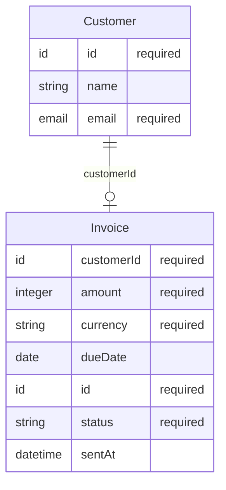

# Data

2 entities, how they relate, and who reads, writes and shows them. Fields, types and examples are in [the domain model](back/domain.md); lifecycles in [logic](LOGIC.md).

## Customer

| | |
|---|---|
| Fields | `id`, `name`?, `email` ([details](back/domain.md#entity-customer)) |
| Relations | — |
| Written by | — |
| Read by | [Customers](FUNCTIONS.md#fn-customers) |
| Shown on | — |
| Operations | [`GET /customers`](back/api.md#op-ep-get-customers) |

## Invoice

| | |
|---|---|
| Fields | `customerId`, `amount`, `currency`, `dueDate`?, `id`, `status`, `sentAt`? ([details](back/domain.md#entity-invoice)) |
| Relations | `customerId` → [Customer](#data-customer) |
| Written by | [Invoices](FUNCTIONS.md#fn-invoices) |
| Read by | [Invoices](FUNCTIONS.md#fn-invoices) |
| Shown on | — |
| Operations | [`GET /invoices`](back/api.md#op-ep-get-invoices) · [`POST /invoices`](back/api.md#op-ep-post-invoices) · [`GET /invoices/{id}`](back/api.md#op-ep-get-invoices-id) · [`POST /invoices/{id}/send`](back/api.md#op-ep-post-invoices-id-send) |
| Lifecycle | [`draft` → `open` → `paid` → `void`](LOGIC.md#states-invoice-status) |

## Notes

<!-- weshcraft:notes:start -->
_Ownership, retention, privacy (personal data), volumes, indexes, migrations._
<!-- weshcraft:notes:end -->

<!-- weshcraft:contract
{
 "entities": [
  {
   "fields": [
    "id",
    "name",
    "email"
   ],
   "name": "Customer",
   "readBy": [
    "fn-customers"
   ],
   "relations": [],
   "shownOn": [],
   "writtenBy": []
  },
  {
   "fields": [
    "customerId",
    "amount",
    "currency",
    "dueDate",
    "id",
    "status",
    "sentAt"
   ],
   "name": "Invoice",
   "readBy": [
    "fn-invoices"
   ],
   "relations": [
    {
     "field": "customerId",
     "many": false,
     "to": "Customer"
    }
   ],
   "shownOn": [],
   "writtenBy": [
    "fn-invoices"
   ]
  }
 ],
 "kind": "data",
 "sourceHash": "06ae1ccbb7dfb23a"
}
-->
