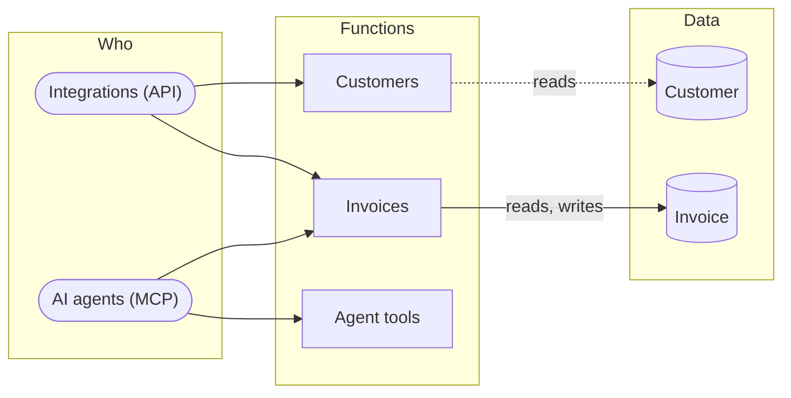

# How the product works

3 functions: [Invoices](#fn-invoices) · [Customers](#fn-customers) · [Agent tools](#fn-agent-tools). Who uses each one, the data it reads and writes, and where it leads. The screen, API and map specs refer to these functions.

**Suggested.** These functions are grouped from the prototype (flows, sections, navigation, API tags). Name them and give each a purpose (`design_functions`, or the Functions view) to make them the product's.

Legend: ⇒ leads to (the user moves on to) · → writes · ⇢ reads.

## Invoices

_Purpose not described yet._

| | |
|---|---|
| Who | AI agents (MCP), Integrations (API) |
| Operations | [`GET /invoices`](back/api.md#op-ep-get-invoices) · [`POST /invoices`](back/api.md#op-ep-post-invoices) · [`GET /invoices/{id}`](back/api.md#op-ep-get-invoices-id) · [`POST /invoices/{id}/send`](back/api.md#op-ep-post-invoices-id-send) |
| Public API | [`GET /invoices`](front/api/ep-get-invoices.md) · [`POST /invoices`](front/api/ep-post-invoices.md) · [`GET /invoices/{id}`](front/api/ep-get-invoices-id.md) · [`POST /invoices/{id}/send`](front/api/ep-post-invoices-id-send.md) |
| MCP tools | [`create_invoice`](front/mcp/tool-create-invoice.md) · [`list_invoices`](front/mcp/tool-list-invoices.md) · [`send_invoice`](front/mcp/tool-send-invoice.md) |
| Data | [Invoice](back/domain.md#entity-invoice) (reads, writes) |
| Leads to | — |
| Code | tag `@weshcraft fn-invoices` · [what implements it](TRACE.md) |

## Customers

_Purpose not described yet._

| | |
|---|---|
| Who | Integrations (API) |
| Operations | [`GET /customers`](back/api.md#op-ep-get-customers) |
| Public API | [`GET /customers`](front/api/ep-get-customers.md) |
| Data | [Customer](back/domain.md#entity-customer) (reads) |
| Leads to | — |
| Code | tag `@weshcraft fn-customers` · [what implements it](TRACE.md) |

## Agent tools

_Purpose not described yet._

| | |
|---|---|
| Who | AI agents (MCP) |
| MCP tools | [`void_invoice`](front/mcp/tool-void-invoice.md) |
| Data | — |
| Leads to | — |
| Code | tag `@weshcraft fn-agent-tools` · [what implements it](TRACE.md) |

## Notes

<!-- weshcraft:notes:start -->
_Product notes: goals, what is out of scope, open questions._
<!-- weshcraft:notes:end -->

<!-- weshcraft:contract
{
 "declared": false,
 "functions": [
  {
   "entities": [
    {
     "access": "reads, writes",
     "name": "Invoice"
    }
   ],
   "key": "fn-invoices",
   "name": "Invoices",
   "next": [],
   "operations": [
    "op-ep-get-invoices",
    "op-ep-post-invoices",
    "op-ep-get-invoices-id",
    "op-ep-post-invoices-id-send"
   ],
   "screens": [],
   "summary": "",
   "tools": [
    "create_invoice",
    "list_invoices",
    "send_invoice"
   ]
  },
  {
   "entities": [
    {
     "access": "reads",
     "name": "Customer"
    }
   ],
   "key": "fn-customers",
   "name": "Customers",
   "next": [],
   "operations": [
    "op-ep-get-customers"
   ],
   "screens": [],
   "summary": "",
   "tools": []
  },
  {
   "entities": [],
   "key": "fn-agent-tools",
   "name": "Agent tools",
   "next": [],
   "operations": [],
   "screens": [],
   "summary": "",
   "tools": [
    "void_invoice"
   ]
  }
 ],
 "kind": "functions",
 "sourceHash": "06ae1ccbb7dfb23a",
 "unassigned": {
  "operations": [],
  "screens": [],
  "tools": []
 }
}
-->
