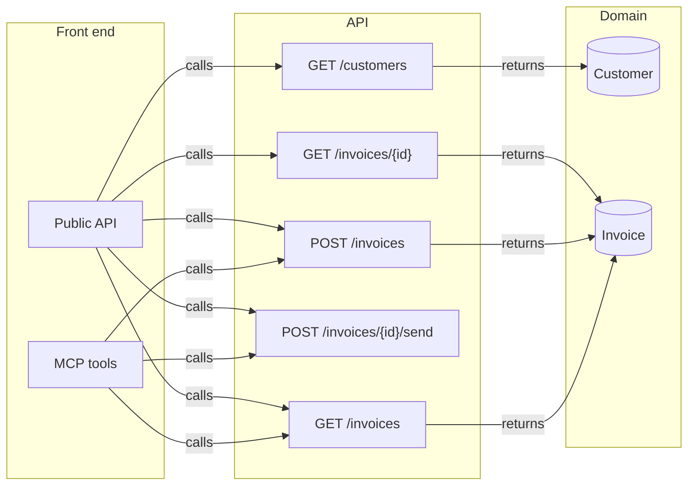

# Front ⇄ back links

Every place where the prototype meets the back end: 8 operation links and 0 data links across 2 screens. No gaps.

Legend: ▶ triggers an operation · ⇢ submits a request field · ☰ list filled by an operation · ◉ shows an entity field · ⚙ MCP tool calls it · ↗ public endpoint.

## Map

## Operations → front end

### [`GET /invoices`](back/api.md#op-ep-get-invoices) — List invoices

Public API: [`GET /invoices`](front/api/ep-get-invoices.md) · list · explicit · returns [`Invoice[]`](back/domain.md#entity-invoice)

| Link | Layer | Element |
|---|---|---|
| ↗ public endpoint | `GET /invoices` | GET /invoices |
| ⚙ MCP tool calls it | `list_invoices` | list_invoices |

### [`POST /invoices`](back/api.md#op-ep-post-invoices) — Create a draft invoice

Public API: [`POST /invoices`](front/api/ep-post-invoices.md) · endpoint · explicit · returns [`Invoice`](back/domain.md#entity-invoice)

| Link | Layer | Element |
|---|---|---|
| ↗ public endpoint | `POST /invoices` | POST /invoices |
| ⚙ MCP tool calls it | `create_invoice` | create_invoice |

### [`GET /invoices/{id}`](back/api.md#op-ep-get-invoices-id) — Get one invoice

Public API: [`GET /invoices/{id}`](front/api/ep-get-invoices-id.md) · endpoint · explicit · returns [`Invoice`](back/domain.md#entity-invoice)

| Link | Layer | Element |
|---|---|---|
| ↗ public endpoint | `GET /invoices/{id}` | GET /invoices/{id} |

### [`POST /invoices/{id}/send`](back/api.md#op-ep-post-invoices-id-send) — Email the invoice to the customer

Public API: [`POST /invoices/{id}/send`](front/api/ep-post-invoices-id-send.md) · endpoint · explicit

| Link | Layer | Element |
|---|---|---|
| ↗ public endpoint | `POST /invoices/{id}/send` | POST /invoices/{id}/send |
| ⚙ MCP tool calls it | `send_invoice` | send_invoice |

### [`GET /customers`](back/api.md#op-ep-get-customers) — List customers

Public API: [`GET /customers`](front/api/ep-get-customers.md) · list · explicit · returns [`Customer[]`](back/domain.md#entity-customer)

| Link | Layer | Element |
|---|---|---|
| ↗ public endpoint | `GET /customers` | GET /customers |

## Domain → front end

### [Customer](back/domain.md#entity-customer)

| Field | Shown by | Screens | Loaded by |
|---|---|---|---|
| `id` | — | — | — |
| `name` | — | — | — |
| `email` | — | — | — |

### [Invoice](back/domain.md#entity-invoice)

| Field | Shown by | Screens | Loaded by |
|---|---|---|---|
| `customerId` | — | — | — |
| `amount` | — | — | — |
| `currency` | — | — | — |
| `dueDate` | — | — | — |
| `id` | — | — | — |
| `status` | — | — | — |
| `sentAt` | — | — | — |

## Gaps

None: every field shown is loaded by an operation on its screen, and every operation is reached from a layer.

## Notes

<!-- weshcraft:notes:start -->
_No notes yet._
<!-- weshcraft:notes:end -->

<!-- weshcraft:contract
{
 "edges": [
  {
   "node": "ep:GET /invoices",
   "op": "op-ep-get-invoices",
   "rel": "exposes"
  },
  {
   "node": "ep:POST /invoices",
   "op": "op-ep-post-invoices",
   "rel": "exposes"
  },
  {
   "node": "ep:GET /invoices/{id}",
   "op": "op-ep-get-invoices-id",
   "rel": "exposes"
  },
  {
   "node": "ep:POST /invoices/{id}/send",
   "op": "op-ep-post-invoices-id-send",
   "rel": "exposes"
  },
  {
   "node": "ep:GET /customers",
   "op": "op-ep-get-customers",
   "rel": "exposes"
  },
  {
   "node": "tool:create_invoice",
   "op": "op-ep-post-invoices",
   "rel": "invokes"
  },
  {
   "node": "tool:list_invoices",
   "op": "op-ep-get-invoices",
   "rel": "invokes"
  },
  {
   "node": "tool:send_invoice",
   "op": "op-ep-post-invoices-id-send",
   "rel": "invokes"
  }
 ],
 "gaps": 0,
 "kind": "links",
 "sourceHash": "4adc5ece25fbe421"
}
-->
