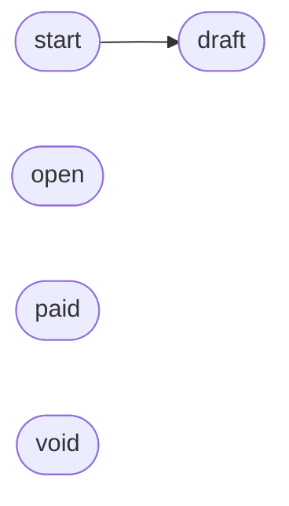

# Logic

What the screens and the API cannot show: 2 rules and 1 lifecycle. Nothing is declared yet: what follows is inferred from the design and the API (required fields, status values, operations). Declare rules and lifecycles with `design_logic` or in the Logic view.

## Lifecycles

### Invoice.status (inferred)

States: `draft` → `open` → `paid` → `void` (starts as `draft`, on [`POST /invoices`](back/api.md#op-ep-post-invoices)).

Open: [`POST /invoices/{id}/send`](back/api.md#op-ep-post-invoices-id-send) changes Invoice but no state says to what: declare the transition.

## Rules

### Validation

| Rule | Details | Applies to |
|---|---|---|
| POST /invoices requires customerId, amount, currency _(inferred)_ | customerId (uuid); amount (integer); currency (string): one of EUR, USD, GBP | [`POST /invoices`](back/api.md#op-ep-post-invoices) |

### Permission

| Rule | Details | Applies to |
|---|---|---|
| Public API requires bearer authentication _(inferred)_ | bearer: http bearer | — |

## Notes

<!-- weshcraft:notes:start -->
_Edge cases, invariants, open questions about the logic._
<!-- weshcraft:notes:end -->

<!-- weshcraft:contract
{
 "declared": false,
 "kind": "logic",
 "machines": [
  {
   "entity": "Invoice",
   "field": "status",
   "initial": "draft",
   "key": "states-invoice-status",
   "source": "inferred",
   "states": [
    "draft",
    "open",
    "paid",
    "void"
   ],
   "transitions": []
  }
 ],
 "rules": [
  {
   "applies": [
    "op-ep-post-invoices"
   ],
   "key": "rule-post-invoices-required",
   "kind": "validation",
   "name": "POST /invoices requires customerId, amount, currency",
   "source": "inferred",
   "text": "customerId (uuid); amount (integer); currency (string): one of EUR, USD, GBP"
  },
  {
   "applies": [],
   "key": "rule-api-auth",
   "kind": "permission",
   "name": "Public API requires bearer authentication",
   "source": "inferred",
   "text": "bearer: http bearer"
  }
 ],
 "sourceHash": "06ae1ccbb7dfb23a"
}
-->
