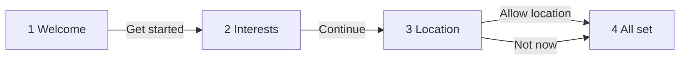

# Navigation and flows

| Flow | Starts at | Description |
|---|---|---|
| Onboarding | [1 Welcome](screens/scr-1-welcome.md) | — |

| From | Element | To | Transition |
|---|---|---|---|
| 1 Welcome | `#21` Get started | 2 Interests | push |
| 2 Interests | `#87` Continue | 3 Location | push |
| 3 Location | `#125` Allow location | 4 All set | dissolve |
| 3 Location | `#127` Not now | 4 All set | moveIn |

## Notes

<!-- weshcraft:notes:start -->
_No notes yet. Agent or human additions go here; WeshCraft keeps this block when it regenerates the file._
<!-- weshcraft:notes:end -->

<!-- weshcraft:contract
{
 "edges": [
  {
   "from": "scr-1-welcome",
   "node": 21,
   "to": "scr-2-interests"
  },
  {
   "from": "scr-2-interests",
   "node": 87,
   "to": "scr-3-location"
  },
  {
   "from": "scr-3-location",
   "node": 125,
   "to": "scr-4-all-set"
  },
  {
   "from": "scr-3-location",
   "node": 127,
   "to": "scr-4-all-set"
  }
 ],
 "kind": "front-flows",
 "sourceHash": "4eb686542c05a6f7"
}
-->
