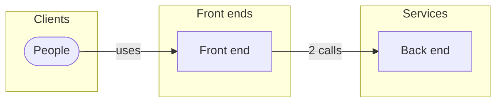

# Architecture

3 components and how they talk. Suggested from the design, the API and the MCP surface: declare the real one (the Architecture view, or `weshcraft_edit` {op:"component"} / {op:"connect"}) with its technologies.

| Component | Kind | Technology | Implements | Code |
|---|---|---|---|---|
| **People** Use the app | client | — | — | — |
| **Front end** The app people use | frontend | — | [1 Welcome](front/screens/scr-1-welcome.md) · [2 Interests](front/screens/scr-2-interests.md) · [3 Location](front/screens/scr-3-location.md) · [4 All set](front/screens/scr-4-all-set.md) | — |
| **Back end** Runs the operations and the rules | service | — | [`POST /interests/continue`](back/api.md#op-continue-87) · [`POST /location/allow`](back/api.md#op-allow-location-125) | — |

| From | To | How |
|---|---|---|
| People | Front end | uses |
| Front end | Back end | 2 calls |

## Notes

<!-- weshcraft:notes:start -->
_Decisions and their reasons (ADRs), deployment, environments, scaling, security boundaries._
<!-- weshcraft:notes:end -->

<!-- weshcraft:contract
{
 "components": [
  {
   "implements": [],
   "key": "arc-people",
   "kind": "client",
   "name": "People",
   "tech": ""
  },
  {
   "implements": [
    "scr-1-welcome",
    "scr-2-interests",
    "scr-3-location",
    "scr-4-all-set"
   ],
   "key": "arc-front-end",
   "kind": "frontend",
   "name": "Front end",
   "tech": ""
  },
  {
   "implements": [
    "op-continue-87",
    "op-allow-location-125"
   ],
   "key": "arc-back-end",
   "kind": "service",
   "name": "Back end",
   "tech": ""
  }
 ],
 "declared": false,
 "kind": "architecture",
 "links": [
  {
   "from": "arc-people",
   "label": "uses",
   "to": "arc-front-end"
  },
  {
   "from": "arc-front-end",
   "label": "2 calls",
   "to": "arc-back-end"
  }
 ],
 "sourceHash": "e249123dd8bfcc22"
}
-->
