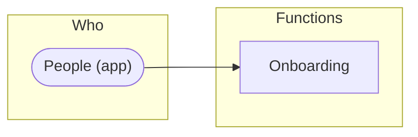

# How the product works

1 function: [Onboarding](#fn-onboarding). Who uses each one, the data it reads and writes, and where it leads. The screen, API and map specs refer to these functions.

**Suggested.** These functions are grouped from the prototype (flows, sections, navigation, API tags). Name them and give each a purpose (the Functions view, or `weshcraft_edit` {op:"function"}) to make them the product's.

Legend: ⇒ leads to (the user moves on to) · → writes · ⇢ reads.

## Onboarding

_Purpose not described yet._

| | |
|---|---|
| Who | People (app) |
| Screens | [1 Welcome](front/screens/scr-1-welcome.md) → [2 Interests](front/screens/scr-2-interests.md) → [3 Location](front/screens/scr-3-location.md) → [4 All set](front/screens/scr-4-all-set.md) |
| Operations | [`POST /interests/continue`](back/api.md#op-continue-87) · [`POST /location/allow`](back/api.md#op-allow-location-125) |
| Data | — |
| Leads to | — |
| Code | tag `@weshcraft fn-onboarding` · [what implements it](TRACE.md) |

## Notes

<!-- weshcraft:notes:start -->
_Product notes: goals, what is out of scope, open questions._
<!-- weshcraft:notes:end -->

<!-- weshcraft:contract
{
 "declared": false,
 "functions": [
  {
   "entities": [],
   "key": "fn-onboarding",
   "name": "Onboarding",
   "next": [],
   "operations": [
    "op-continue-87",
    "op-allow-location-125"
   ],
   "screens": [
    "scr-1-welcome",
    "scr-2-interests",
    "scr-3-location",
    "scr-4-all-set"
   ],
   "summary": "",
   "tools": []
  }
 ],
 "kind": "functions",
 "sourceHash": "e249123dd8bfcc22",
 "unassigned": {
  "operations": [],
  "screens": [],
  "tools": []
 }
}
-->
