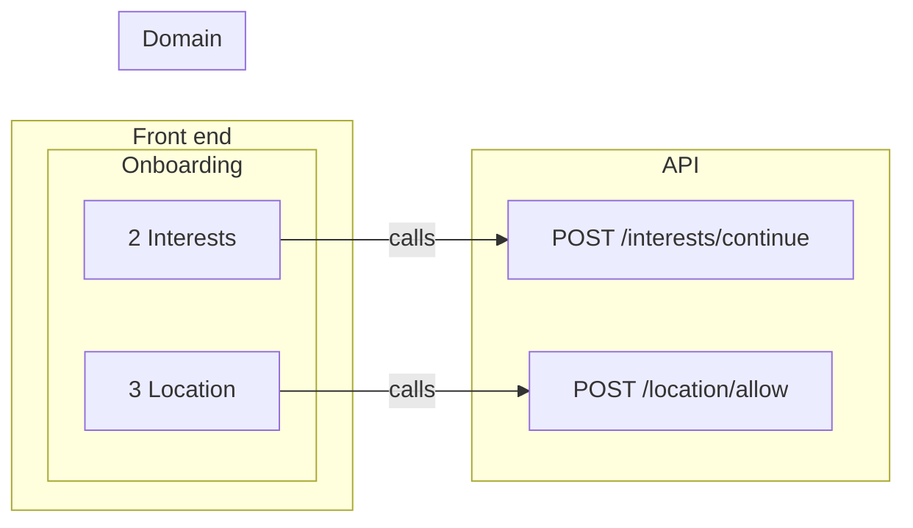

# Front ⇄ back links

Every place where the prototype meets the back end: 2 operation links and 0 data links across 2 screens. No gaps.

Legend: ▶ triggers an operation · ⇢ submits a request field · ☰ list filled by an operation · ◉ shows an entity field · ⚙ MCP tool calls it · ↗ public endpoint.

## Map

## Operations → front end

### [`POST /interests/continue`](back/api.md#op-continue-87) — Continue

Screen: [2 Interests](front/screens/scr-2-interests.md) · action · inferred

| Link | Layer | Element |
|---|---|---|
| ▶ triggers | `#87` | Continue |

### [`POST /location/allow`](back/api.md#op-allow-location-125) — Allow location

Screen: [3 Location](front/screens/scr-3-location.md) · action · inferred

| Link | Layer | Element |
|---|---|---|
| ▶ triggers | `#125` | Allow location |

## Domain → front end

No entity is shown. Bind a layer to data (WeshCraft: Spec section › Shows, or `weshcraft_edit` {op:"bind"}; FigCraft: `{{entity.field}}` in text) to add one.
## Gaps

None: every field shown is loaded by an operation on its screen, and every operation is reached from a layer.

## Notes

<!-- weshcraft:notes:start -->
_No notes yet._
<!-- weshcraft:notes:end -->

<!-- weshcraft:contract
{
 "edges": [
  {
   "node": 87,
   "op": "op-continue-87",
   "rel": "triggers"
  },
  {
   "node": 125,
   "op": "op-allow-location-125",
   "rel": "triggers"
  }
 ],
 "gaps": 0,
 "kind": "links",
 "sourceHash": "e249123dd8bfcc22"
}
-->
