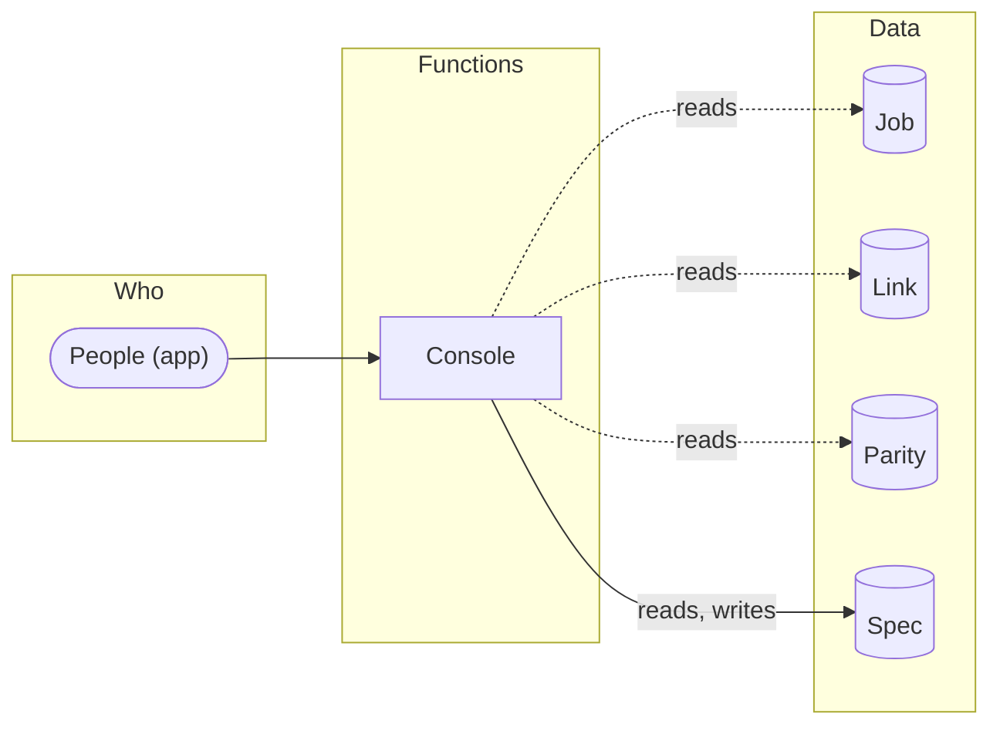

# How the product works

1 function: [Console](#fn-console). Who uses each one, the data it reads and writes, and where it leads. The screen, API and map specs refer to these functions.

**Suggested.** These functions are grouped from the prototype (flows, sections, navigation, API tags). Name them and give each a purpose (`design_functions`, or the Functions view) to make them the product's.

Legend: ⇒ leads to (the user moves on to) · → writes · ⇢ reads.

## Console

_Purpose not described yet._

| | |
|---|---|
| Who | People (app) |
| Screens | [Console — Light](front/screens/scr-console-light.md) |
| Operations | [`GET /jobs`](back/api.md#op-get-jobs-2) · [`POST /specs/publish`](back/api.md#op-post-specs-publish-54) · [`GET /parity`](back/api.md#op-get-parity-56) · [`GET /parity/trend`](back/api.md#op-get-parity-trend-80) · [`GET /links`](back/api.md#op-get-links-101) · [`GET /parity/history`](back/api.md#op-get-parity-history-123) · [`GET /specs`](back/api.md#op-get-specs-144) |
| Data | [Job](back/domain.md#entity-job) (reads) · [Link](back/domain.md#entity-link) (reads) · [Parity](back/domain.md#entity-parity) (reads) · [Spec](back/domain.md#entity-spec) (reads, writes) |
| Leads to | — |

## Notes

<!-- weshcraft:notes:start -->
_Product notes: goals, what is out of scope, open questions._
<!-- weshcraft:notes:end -->

<!-- weshcraft:contract
{
 "declared": false,
 "functions": [
  {
   "entities": [
    {
     "access": "reads",
     "name": "Job"
    },
    {
     "access": "reads",
     "name": "Link"
    },
    {
     "access": "reads",
     "name": "Parity"
    },
    {
     "access": "reads, writes",
     "name": "Spec"
    }
   ],
   "key": "fn-console",
   "name": "Console",
   "next": [],
   "operations": [
    "op-get-jobs-2",
    "op-post-specs-publish-54",
    "op-get-parity-56",
    "op-get-parity-trend-80",
    "op-get-links-101",
    "op-get-parity-history-123",
    "op-get-specs-144"
   ],
   "screens": [
    "scr-console-light"
   ],
   "summary": "",
   "tools": []
  }
 ],
 "kind": "functions",
 "sourceHash": "d69943427aa24a1d",
 "unassigned": {
  "operations": [],
  "screens": [],
  "tools": []
 }
}
-->
