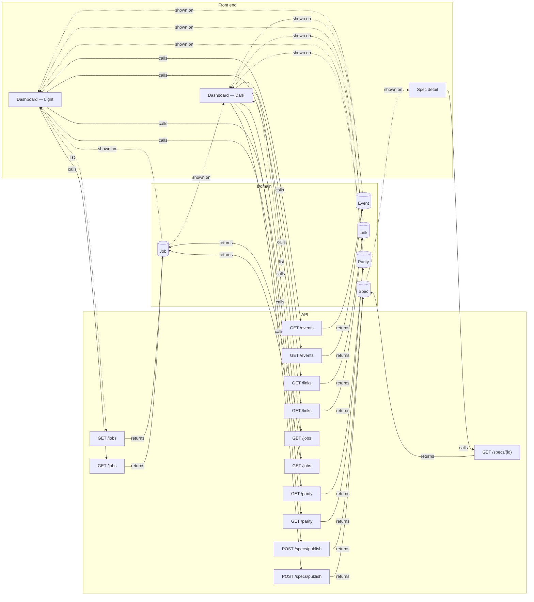

# Front ⇄ back links

Every place where the prototype meets the back end: 17 operation links and 49 data links across 3 screens. No gaps.

Legend: ▶ triggers an operation · ⇢ submits a request field · ☰ list filled by an operation · ◉ shows an entity field · ⚙ MCP tool calls it · ↗ public endpoint.

## Map

## Operations → front end

### [`GET /jobs`](back/api.md#op-list-job-scr-dashboard-light) — List Job

Screen: [Dashboard — Light](front/screens/scr-dashboard-light.md) · list · inferred · returns [`Job[]`](back/domain.md#entity-job)

| Link | Layer | Element |
|---|---|---|
| ☰ is filled by | `#39` | Job row 1 |
| ☰ is filled by | `#43` | Job row 2 |
| ☰ is filled by | `#47` | Job row 3 |
| ☰ is filled by | `#51` | Job row 4 |

### [`GET /jobs`](back/api.md#op-get-jobs-6) — GET /jobs → Job

Screen: [Dashboard — Light](front/screens/scr-dashboard-light.md) · annotated · explicit · returns [`Job`](back/domain.md#entity-job)

| Link | Layer | Element |
|---|---|---|
| ◉ response `Job.file` shown | `#40` | specs/front/screens/scr-home-light.md |
| ◉ response `Job.file` shown | `#44` | specs/front/screens/scr-trail-light.md |
| ◉ response `Job.file` shown | `#48` | specs/back/api.md |
| ◉ response `Job.file` shown | `#52` | specs/LINKS.md |
| ◉ response `Job.status` shown | `#41` | done |
| ◉ response `Job.status` shown | `#45` | done |
| ◉ response `Job.status` shown | `#49` | changed |
| ◉ response `Job.status` shown | `#53` | done |
| ◉ response `Job.updated` shown | `#42` | 2 min ago |
| ◉ response `Job.updated` shown | `#46` | 3 min ago |
| ◉ response `Job.updated` shown | `#50` | 5 min ago |
| ◉ response `Job.updated` shown | `#54` | 5 min ago |
| — | — | not reached from any layer |

### [`POST /specs/publish`](back/api.md#op-post-specs-publish-23) — POST /specs/publish → Spec

Screen: [Dashboard — Light](front/screens/scr-dashboard-light.md) · annotated · explicit · returns [`Spec`](back/domain.md#entity-spec)

| Link | Layer | Element |
|---|---|---|
| ▶ triggers | `#23` | Publish |
| ⇢ submits | `#21` | Search jobs |

### [`GET /parity`](back/api.md#op-get-parity-25) — GET /parity → Parity

Screen: [Dashboard — Light](front/screens/scr-dashboard-light.md) · annotated · explicit · returns [`Parity`](back/domain.md#entity-parity)

| Link | Layer | Element |
|---|---|---|
| ▶ triggers | `#25` | Parity |
| ◉ response `Parity.score` shown | `#27` | {{parity.score}} |
| ◉ response `Parity.checks` shown | `#30` | {{parity.checks}} |
| ◉ response `Parity.errors` shown | `#33` | {{parity.errors}} |
| ◉ response `Parity.screens` shown | `#36` | {{parity.screens}} |

### [`GET /links`](back/api.md#op-get-links-55) — GET /links → Link

Screen: [Dashboard — Light](front/screens/scr-dashboard-light.md) · annotated · explicit · returns [`Link`](back/domain.md#entity-link)

| Link | Layer | Element |
|---|---|---|
| ▶ triggers | `#55` | Front ⇄ back |
| ◉ response `Link.rel` shown | `#59` | {{link.rel}} · {{link.target}} |
| ◉ response `Link.rel` shown | `#62` | {{link.rel}} · {{link.target}} |
| ◉ response `Link.rel` shown | `#65` | {{link.rel}} · {{link.target}} |

### [`GET /events`](back/api.md#op-get-events-66) — GET /events → Event

Screen: [Dashboard — Light](front/screens/scr-dashboard-light.md) · annotated · explicit · returns [`Event`](back/domain.md#entity-event)

| Link | Layer | Element |
|---|---|---|
| ▶ triggers | `#66` | Live feed |
| ◉ response `Event.message` shown | `#68` | {{event.message}} |
| ◉ response `Event.message` shown | `#69` | {{event.message}} |
| ◉ response `Event.message` shown | `#70` | {{event.message}} |

### [`GET /jobs`](back/api.md#op-list-job-scr-dashboard-dark) — List Job

Screen: [Dashboard — Dark](front/screens/scr-dashboard-dark.md) · list · inferred · returns [`Job[]`](back/domain.md#entity-job)

| Link | Layer | Element |
|---|---|---|
| ☰ is filled by | `#104` | Job row 1 |
| ☰ is filled by | `#108` | Job row 2 |
| ☰ is filled by | `#112` | Job row 3 |

### [`GET /jobs`](back/api.md#op-get-jobs-71) — GET /jobs → Job

Screen: [Dashboard — Dark](front/screens/scr-dashboard-dark.md) · annotated · explicit · returns [`Job`](back/domain.md#entity-job)

| Link | Layer | Element |
|---|---|---|
| ◉ response `Job.file` shown | `#105` | specs/front/screens/scr-home-light.md |
| ◉ response `Job.file` shown | `#109` | specs/front/screens/scr-trail-light.md |
| ◉ response `Job.file` shown | `#113` | specs/back/api.md |
| ◉ response `Job.status` shown | `#106` | done |
| ◉ response `Job.status` shown | `#110` | done |
| ◉ response `Job.status` shown | `#114` | changed |
| ◉ response `Job.updated` shown | `#107` | 2 min ago |
| ◉ response `Job.updated` shown | `#111` | 3 min ago |
| ◉ response `Job.updated` shown | `#115` | 5 min ago |
| — | — | not reached from any layer |

### [`POST /specs/publish`](back/api.md#op-post-specs-publish-88) — POST /specs/publish → Spec

Screen: [Dashboard — Dark](front/screens/scr-dashboard-dark.md) · annotated · explicit · returns [`Spec`](back/domain.md#entity-spec)

| Link | Layer | Element |
|---|---|---|
| ▶ triggers | `#88` | Publish |
| ⇢ submits | `#86` | Search jobs |

### [`GET /parity`](back/api.md#op-get-parity-90) — GET /parity → Parity

Screen: [Dashboard — Dark](front/screens/scr-dashboard-dark.md) · annotated · explicit · returns [`Parity`](back/domain.md#entity-parity)

| Link | Layer | Element |
|---|---|---|
| ▶ triggers | `#90` | Parity |
| ◉ response `Parity.score` shown | `#92` | {{parity.score}} |
| ◉ response `Parity.checks` shown | `#95` | {{parity.checks}} |
| ◉ response `Parity.errors` shown | `#98` | {{parity.errors}} |
| ◉ response `Parity.screens` shown | `#101` | {{parity.screens}} |

### [`GET /links`](back/api.md#op-get-links-116) — GET /links → Link

Screen: [Dashboard — Dark](front/screens/scr-dashboard-dark.md) · annotated · explicit · returns [`Link`](back/domain.md#entity-link)

| Link | Layer | Element |
|---|---|---|
| ▶ triggers | `#116` | Front ⇄ back |
| ◉ response `Link.rel` shown | `#120` | {{link.rel}} · {{link.target}} |
| ◉ response `Link.rel` shown | `#123` | {{link.rel}} · {{link.target}} |
| ◉ response `Link.rel` shown | `#126` | {{link.rel}} · {{link.target}} |

### [`GET /events`](back/api.md#op-get-events-127) — GET /events → Event

Screen: [Dashboard — Dark](front/screens/scr-dashboard-dark.md) · annotated · explicit · returns [`Event`](back/domain.md#entity-event)

| Link | Layer | Element |
|---|---|---|
| ▶ triggers | `#127` | Live feed |
| ◉ response `Event.message` shown | `#129` | {{event.message}} |
| ◉ response `Event.message` shown | `#130` | {{event.message}} |

### [`GET /specs/{id}`](back/api.md#op-get-specs-id-131) — GET /specs/{id} → Spec

Screen: [Spec detail](front/screens/scr-spec-detail.md) · annotated · explicit · returns [`Spec`](back/domain.md#entity-spec)

| Link | Layer | Element |
|---|---|---|
| ◉ response `Spec.title` shown | `#134` | {{spec.title}} |
| ◉ response `Spec.file` shown | `#135` | {{spec.file}} |
| ◉ response `Spec.status` shown | `#137` | {{spec.status}} |
| ◉ response `Spec.heading` shown | `#139` | {{spec.heading}} |
| ◉ response `Spec.fingerprint` shown | `#148` | {{spec.fingerprint}} |
| ◉ response `Spec.checks` shown | `#150` | {{spec.checks}} |
| ◉ response `Spec.errors` shown | `#152` | {{spec.errors}} |
| ◉ response `Spec.layer` shown | `#154` | {{spec.layer}} |
| ◉ response `Spec.owner` shown | `#156` | {{spec.owner}} |
| — | — | not reached from any layer |

## Domain → front end

### [Event](back/domain.md#entity-event)

| Field | Shown by | Screens | Loaded by |
|---|---|---|---|
| `message` | `#68` `#69` `#70` `#129` `#130` | [Dashboard — Light](front/screens/scr-dashboard-light.md), [Dashboard — Dark](front/screens/scr-dashboard-dark.md) | [`GET /events`](back/api.md#op-get-events-66), [`GET /events`](back/api.md#op-get-events-127) |

### [Job](back/domain.md#entity-job)

| Field | Shown by | Screens | Loaded by |
|---|---|---|---|
| `file` | `#40` `#44` `#48` `#52` `#105` `#109` `#113` | [Dashboard — Light](front/screens/scr-dashboard-light.md), [Dashboard — Dark](front/screens/scr-dashboard-dark.md) | [`GET /jobs`](back/api.md#op-get-jobs-6), [`GET /jobs`](back/api.md#op-get-jobs-71) |
| `status` | `#41` `#45` `#49` `#53` `#106` `#110` `#114` | [Dashboard — Light](front/screens/scr-dashboard-light.md), [Dashboard — Dark](front/screens/scr-dashboard-dark.md) | [`GET /jobs`](back/api.md#op-get-jobs-6), [`GET /jobs`](back/api.md#op-get-jobs-71) |
| `updated` | `#42` `#46` `#50` `#54` `#107` `#111` `#115` | [Dashboard — Light](front/screens/scr-dashboard-light.md), [Dashboard — Dark](front/screens/scr-dashboard-dark.md) | [`GET /jobs`](back/api.md#op-get-jobs-6), [`GET /jobs`](back/api.md#op-get-jobs-71) |

### [Link](back/domain.md#entity-link)

| Field | Shown by | Screens | Loaded by |
|---|---|---|---|
| `rel` | `#59` `#62` `#65` `#120` `#123` `#126` | [Dashboard — Light](front/screens/scr-dashboard-light.md), [Dashboard — Dark](front/screens/scr-dashboard-dark.md) | [`GET /links`](back/api.md#op-get-links-55), [`GET /links`](back/api.md#op-get-links-116) |

### [Parity](back/domain.md#entity-parity)

| Field | Shown by | Screens | Loaded by |
|---|---|---|---|
| `score` | `#27` `#92` | [Dashboard — Light](front/screens/scr-dashboard-light.md), [Dashboard — Dark](front/screens/scr-dashboard-dark.md) | [`GET /parity`](back/api.md#op-get-parity-25), [`GET /parity`](back/api.md#op-get-parity-90) |
| `checks` | `#30` `#95` | [Dashboard — Light](front/screens/scr-dashboard-light.md), [Dashboard — Dark](front/screens/scr-dashboard-dark.md) | [`GET /parity`](back/api.md#op-get-parity-25), [`GET /parity`](back/api.md#op-get-parity-90) |
| `errors` | `#33` `#98` | [Dashboard — Light](front/screens/scr-dashboard-light.md), [Dashboard — Dark](front/screens/scr-dashboard-dark.md) | [`GET /parity`](back/api.md#op-get-parity-25), [`GET /parity`](back/api.md#op-get-parity-90) |
| `screens` | `#36` `#101` | [Dashboard — Light](front/screens/scr-dashboard-light.md), [Dashboard — Dark](front/screens/scr-dashboard-dark.md) | [`GET /parity`](back/api.md#op-get-parity-25), [`GET /parity`](back/api.md#op-get-parity-90) |

### [Spec](back/domain.md#entity-spec)

| Field | Shown by | Screens | Loaded by |
|---|---|---|---|
| `title` | `#134` | [Spec detail](front/screens/scr-spec-detail.md) | [`GET /specs/{id}`](back/api.md#op-get-specs-id-131) |
| `file` | `#135` | [Spec detail](front/screens/scr-spec-detail.md) | [`GET /specs/{id}`](back/api.md#op-get-specs-id-131) |
| `status` | `#137` | [Spec detail](front/screens/scr-spec-detail.md) | [`GET /specs/{id}`](back/api.md#op-get-specs-id-131) |
| `heading` | `#139` | [Spec detail](front/screens/scr-spec-detail.md) | [`GET /specs/{id}`](back/api.md#op-get-specs-id-131) |
| `fingerprint` | `#148` | [Spec detail](front/screens/scr-spec-detail.md) | [`GET /specs/{id}`](back/api.md#op-get-specs-id-131) |
| `checks` | `#150` | [Spec detail](front/screens/scr-spec-detail.md) | [`GET /specs/{id}`](back/api.md#op-get-specs-id-131) |
| `errors` | `#152` | [Spec detail](front/screens/scr-spec-detail.md) | [`GET /specs/{id}`](back/api.md#op-get-specs-id-131) |
| `layer` | `#154` | [Spec detail](front/screens/scr-spec-detail.md) | [`GET /specs/{id}`](back/api.md#op-get-specs-id-131) |
| `owner` | `#156` | [Spec detail](front/screens/scr-spec-detail.md) | [`GET /specs/{id}`](back/api.md#op-get-specs-id-131) |

## Gaps

None: every field shown is loaded by an operation on its screen, and every operation is reached from a layer.

## Notes

<!-- weshcraft:notes:start -->
_No notes yet._
<!-- weshcraft:notes:end -->

<!-- weshcraft:contract
{
 "edges": [
  {
   "node": 39,
   "op": "op-list-job-scr-dashboard-light",
   "rel": "lists"
  },
  {
   "node": 43,
   "op": "op-list-job-scr-dashboard-light",
   "rel": "lists"
  },
  {
   "node": 47,
   "op": "op-list-job-scr-dashboard-light",
   "rel": "lists"
  },
  {
   "node": 51,
   "op": "op-list-job-scr-dashboard-light",
   "rel": "lists"
  },
  {
   "node": 23,
   "op": "op-post-specs-publish-23",
   "rel": "triggers"
  },
  {
   "node": 21,
   "op": "op-post-specs-publish-23",
   "rel": "submits"
  },
  {
   "node": 25,
   "op": "op-get-parity-25",
   "rel": "triggers"
  },
  {
   "node": 55,
   "op": "op-get-links-55",
   "rel": "triggers"
  },
  {
   "node": 66,
   "op": "op-get-events-66",
   "rel": "triggers"
  },
  {
   "node": 104,
   "op": "op-list-job-scr-dashboard-dark",
   "rel": "lists"
  },
  {
   "node": 108,
   "op": "op-list-job-scr-dashboard-dark",
   "rel": "lists"
  },
  {
   "node": 112,
   "op": "op-list-job-scr-dashboard-dark",
   "rel": "lists"
  },
  {
   "node": 88,
   "op": "op-post-specs-publish-88",
   "rel": "triggers"
  },
  {
   "node": 86,
   "op": "op-post-specs-publish-88",
   "rel": "submits"
  },
  {
   "node": 90,
   "op": "op-get-parity-90",
   "rel": "triggers"
  },
  {
   "node": 116,
   "op": "op-get-links-116",
   "rel": "triggers"
  },
  {
   "node": 127,
   "op": "op-get-events-127",
   "rel": "triggers"
  },
  {
   "field": "Event.message",
   "node": 68,
   "rel": "displays"
  },
  {
   "field": "Event.message",
   "node": 69,
   "rel": "displays"
  },
  {
   "field": "Event.message",
   "node": 70,
   "rel": "displays"
  },
  {
   "field": "Event.message",
   "node": 129,
   "rel": "displays"
  },
  {
   "field": "Event.message",
   "node": 130,
   "rel": "displays"
  },
  {
   "field": "Job.file",
   "node": 40,
   "rel": "displays"
  },
  {
   "field": "Job.file",
   "node": 44,
   "rel": "displays"
  },
  {
   "field": "Job.file",
   "node": 48,
   "rel": "displays"
  },
  {
   "field": "Job.file",
   "node": 52,
   "rel": "displays"
  },
  {
   "field": "Job.file",
   "node": 105,
   "rel": "displays"
  },
  {
   "field": "Job.file",
   "node": 109,
   "rel": "displays"
  },
  {
   "field": "Job.file",
   "node": 113,
   "rel": "displays"
  },
  {
   "field": "Job.status",
   "node": 41,
   "rel": "displays"
  },
  {
   "field": "Job.status",
   "node": 45,
   "rel": "displays"
  },
  {
   "field": "Job.status",
   "node": 49,
   "rel": "displays"
  },
  {
   "field": "Job.status",
   "node": 53,
   "rel": "displays"
  },
  {
   "field": "Job.status",
   "node": 106,
   "rel": "displays"
  },
  {
   "field": "Job.status",
   "node": 110,
   "rel": "displays"
  },
  {
   "field": "Job.status",
   "node": 114,
   "rel": "displays"
  },
  {
   "field": "Job.updated",
   "node": 42,
   "rel": "displays"
  },
  {
   "field": "Job.updated",
   "node": 46,
   "rel": "displays"
  },
  {
   "field": "Job.updated",
   "node": 50,
   "rel": "displays"
  },
  {
   "field": "Job.updated",
   "node": 54,
   "rel": "displays"
  },
  {
   "field": "Job.updated",
   "node": 107,
   "rel": "displays"
  },
  {
   "field": "Job.updated",
   "node": 111,
   "rel": "displays"
  },
  {
   "field": "Job.updated",
   "node": 115,
   "rel": "displays"
  },
  {
   "field": "Link.rel",
   "node": 59,
   "rel": "displays"
  },
  {
   "field": "Link.rel",
   "node": 62,
   "rel": "displays"
  },
  {
   "field": "Link.rel",
   "node": 65,
   "rel": "displays"
  },
  {
   "field": "Link.rel",
   "node": 120,
   "rel": "displays"
  },
  {
   "field": "Link.rel",
   "node": 123,
   "rel": "displays"
  },
  {
   "field": "Link.rel",
   "node": 126,
   "rel": "displays"
  },
  {
   "field": "Parity.score",
   "node": 27,
   "rel": "displays"
  },
  {
   "field": "Parity.score",
   "node": 92,
   "rel": "displays"
  },
  {
   "field": "Parity.checks",
   "node": 30,
   "rel": "displays"
  },
  {
   "field": "Parity.checks",
   "node": 95,
   "rel": "displays"
  },
  {
   "field": "Parity.errors",
   "node": 33,
   "rel": "displays"
  },
  {
   "field": "Parity.errors",
   "node": 98,
   "rel": "displays"
  },
  {
   "field": "Parity.screens",
   "node": 36,
   "rel": "displays"
  },
  {
   "field": "Parity.screens",
   "node": 101,
   "rel": "displays"
  },
  {
   "field": "Spec.title",
   "node": 134,
   "rel": "displays"
  },
  {
   "field": "Spec.file",
   "node": 135,
   "rel": "displays"
  },
  {
   "field": "Spec.status",
   "node": 137,
   "rel": "displays"
  },
  {
   "field": "Spec.heading",
   "node": 139,
   "rel": "displays"
  },
  {
   "field": "Spec.fingerprint",
   "node": 148,
   "rel": "displays"
  },
  {
   "field": "Spec.checks",
   "node": 150,
   "rel": "displays"
  },
  {
   "field": "Spec.errors",
   "node": 152,
   "rel": "displays"
  },
  {
   "field": "Spec.layer",
   "node": 154,
   "rel": "displays"
  },
  {
   "field": "Spec.owner",
   "node": 156,
   "rel": "displays"
  }
 ],
 "gaps": 0,
 "kind": "links",
 "sourceHash": "d5a504f901758656"
}
-->
