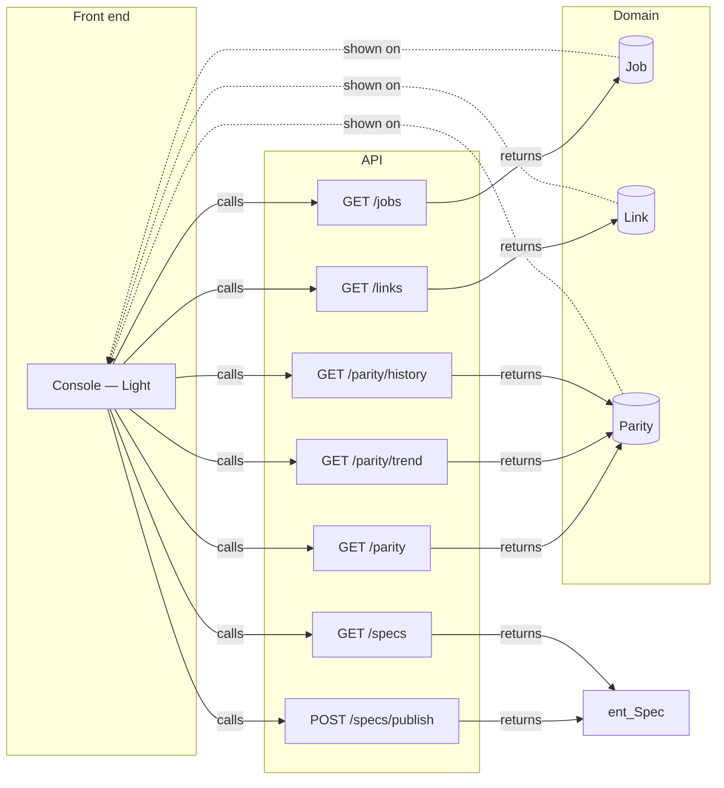

# Front ⇄ back links

Every place where the prototype meets the back end: 8 operation links and 30 data links across 1 screens. No gaps.

Legend: ▶ triggers an operation · ⇢ submits a request field · ☰ list filled by an operation · ◉ shows an entity field · ⚙ MCP tool calls it · ↗ public endpoint.

## Map

## Operations → front end

### [`GET /jobs`](back/api.md#op-get-jobs-2) — GET /jobs → Job

Screen: [Console — Light](front/screens/scr-console-light.md) · annotated · explicit · returns [`Job`](back/domain.md#entity-job)

| Link | Layer | Element |
|---|---|---|
| ◉ response `Job.file` shown | `#156` | specs/front/screens/scr-home-light.md |
| ◉ response `Job.file` shown | `#164` | specs/back/api.md |
| ◉ response `Job.file` shown | `#172` | specs/LINKS.md |
| ◉ response `Job.file` shown | `#180` | specs/back/domain.md |
| ◉ response `Job.group` shown | `#157` | front |
| ◉ response `Job.group` shown | `#165` | back |
| ◉ response `Job.group` shown | `#173` | links |
| ◉ response `Job.group` shown | `#181` | back |
| ◉ response `Job.updated` shown | `#158` | 2 min ago |
| ◉ response `Job.updated` shown | `#166` | 3 min ago |
| ◉ response `Job.updated` shown | `#174` | 5 min ago |
| ◉ response `Job.updated` shown | `#182` | 6 min ago |
| ◉ response `Job.status` shown | `#161` | done |
| ◉ response `Job.status` shown | `#169` | done |
| ◉ response `Job.status` shown | `#177` | changed |
| ◉ response `Job.status` shown | `#185` | done |
| ◉ response `Job.checks` shown | `#162` | 153 |
| ◉ response `Job.checks` shown | `#170` | 96 |
| ◉ response `Job.checks` shown | `#178` | 48 |
| ◉ response `Job.checks` shown | `#186` | 112 |
| — | — | not reached from any layer |

### [`POST /specs/publish`](back/api.md#op-post-specs-publish-54) — POST /specs/publish → Spec

Screen: [Console — Light](front/screens/scr-console-light.md) · annotated · explicit · returns [`Spec`](back/domain.md#entity-spec)

| Link | Layer | Element |
|---|---|---|
| ▶ triggers | `#54` | Publish |
| ⇢ submits | `#46` | Search |
| ⇢ submits | `#47` | Search |

### [`GET /parity`](back/api.md#op-get-parity-56) — GET /parity → Parity

Screen: [Console — Light](front/screens/scr-console-light.md) · annotated · explicit · returns [`Parity`](back/domain.md#entity-parity)

| Link | Layer | Element |
|---|---|---|
| ▶ triggers | `#56` | Parity |

### [`GET /parity/trend`](back/api.md#op-get-parity-trend-80) — GET /parity/trend → Parity

Screen: [Console — Light](front/screens/scr-console-light.md) · annotated · explicit · returns [`Parity`](back/domain.md#entity-parity)

| Link | Layer | Element |
|---|---|---|
| ▶ triggers | `#80` | Parity over time |

### [`GET /links`](back/api.md#op-get-links-101) — GET /links → Link

Screen: [Console — Light](front/screens/scr-console-light.md) · annotated · explicit · returns [`Link`](back/domain.md#entity-link)

| Link | Layer | Element |
|---|---|---|
| ▶ triggers | `#101` | Spec jobs by group |
| ◉ response `Link.rel` shown | `#113` | front |
| ◉ response `Link.rel` shown | `#117` | back |
| ◉ response `Link.rel` shown | `#121` | notes |
| ◉ response `Link.share` shown | `#114` | 62% |
| ◉ response `Link.share` shown | `#118` | 38% |
| ◉ response `Link.share` shown | `#122` | 0% |

### [`GET /parity/history`](back/api.md#op-get-parity-history-123) — GET /parity/history → Parity

Screen: [Console — Light](front/screens/scr-console-light.md) · annotated · explicit · returns [`Parity`](back/domain.md#entity-parity)

| Link | Layer | Element |
|---|---|---|
| ▶ triggers | `#123` | Checks per run |
| ◉ response `Parity.score` shown | `#59` | 100% |
| ◉ response `Parity.checks` shown | `#65` | 576 |
| ◉ response `Parity.errors` shown | `#71` | 0 |
| ◉ response `Parity.screens` shown | `#77` | 3 |

### [`GET /specs`](back/api.md#op-get-specs-144) — GET /specs → Spec

Screen: [Console — Light](front/screens/scr-console-light.md) · annotated · explicit · returns [`Spec`](back/domain.md#entity-spec)

| Link | Layer | Element |
|---|---|---|
| ▶ triggers | `#144` | Spec jobs |

## Domain → front end

### [Job](back/domain.md#entity-job)

| Field | Shown by | Screens | Loaded by |
|---|---|---|---|
| `file` | `#156` `#164` `#172` `#180` | [Console — Light](front/screens/scr-console-light.md) | [`GET /jobs`](back/api.md#op-get-jobs-2) |
| `group` | `#157` `#165` `#173` `#181` | [Console — Light](front/screens/scr-console-light.md) | [`GET /jobs`](back/api.md#op-get-jobs-2) |
| `updated` | `#158` `#166` `#174` `#182` | [Console — Light](front/screens/scr-console-light.md) | [`GET /jobs`](back/api.md#op-get-jobs-2) |
| `status` | `#161` `#169` `#177` `#185` | [Console — Light](front/screens/scr-console-light.md) | [`GET /jobs`](back/api.md#op-get-jobs-2) |
| `checks` | `#162` `#170` `#178` `#186` | [Console — Light](front/screens/scr-console-light.md) | [`GET /jobs`](back/api.md#op-get-jobs-2) |

### [Link](back/domain.md#entity-link)

| Field | Shown by | Screens | Loaded by |
|---|---|---|---|
| `rel` | `#113` `#117` `#121` | [Console — Light](front/screens/scr-console-light.md) | [`GET /links`](back/api.md#op-get-links-101) |
| `share` | `#114` `#118` `#122` | [Console — Light](front/screens/scr-console-light.md) | [`GET /links`](back/api.md#op-get-links-101) |

### [Parity](back/domain.md#entity-parity)

| Field | Shown by | Screens | Loaded by |
|---|---|---|---|
| `score` | `#59` | [Console — Light](front/screens/scr-console-light.md) | [`GET /parity/history`](back/api.md#op-get-parity-history-123) |
| `checks` | `#65` | [Console — Light](front/screens/scr-console-light.md) | [`GET /parity/history`](back/api.md#op-get-parity-history-123) |
| `errors` | `#71` | [Console — Light](front/screens/scr-console-light.md) | [`GET /parity/history`](back/api.md#op-get-parity-history-123) |
| `screens` | `#77` | [Console — Light](front/screens/scr-console-light.md) | [`GET /parity/history`](back/api.md#op-get-parity-history-123) |

## Gaps

None: every field shown is loaded by an operation on its screen, and every operation is reached from a layer.

## Notes

<!-- weshcraft:notes:start -->
_No notes yet._
<!-- weshcraft:notes:end -->

<!-- weshcraft:contract
{
 "edges": [
  {
   "node": 54,
   "op": "op-post-specs-publish-54",
   "rel": "triggers"
  },
  {
   "node": 46,
   "op": "op-post-specs-publish-54",
   "rel": "submits"
  },
  {
   "node": 47,
   "op": "op-post-specs-publish-54",
   "rel": "submits"
  },
  {
   "node": 56,
   "op": "op-get-parity-56",
   "rel": "triggers"
  },
  {
   "node": 80,
   "op": "op-get-parity-trend-80",
   "rel": "triggers"
  },
  {
   "node": 101,
   "op": "op-get-links-101",
   "rel": "triggers"
  },
  {
   "node": 123,
   "op": "op-get-parity-history-123",
   "rel": "triggers"
  },
  {
   "node": 144,
   "op": "op-get-specs-144",
   "rel": "triggers"
  },
  {
   "field": "Job.file",
   "node": 156,
   "rel": "displays"
  },
  {
   "field": "Job.file",
   "node": 164,
   "rel": "displays"
  },
  {
   "field": "Job.file",
   "node": 172,
   "rel": "displays"
  },
  {
   "field": "Job.file",
   "node": 180,
   "rel": "displays"
  },
  {
   "field": "Job.group",
   "node": 157,
   "rel": "displays"
  },
  {
   "field": "Job.group",
   "node": 165,
   "rel": "displays"
  },
  {
   "field": "Job.group",
   "node": 173,
   "rel": "displays"
  },
  {
   "field": "Job.group",
   "node": 181,
   "rel": "displays"
  },
  {
   "field": "Job.updated",
   "node": 158,
   "rel": "displays"
  },
  {
   "field": "Job.updated",
   "node": 166,
   "rel": "displays"
  },
  {
   "field": "Job.updated",
   "node": 174,
   "rel": "displays"
  },
  {
   "field": "Job.updated",
   "node": 182,
   "rel": "displays"
  },
  {
   "field": "Job.status",
   "node": 161,
   "rel": "displays"
  },
  {
   "field": "Job.status",
   "node": 169,
   "rel": "displays"
  },
  {
   "field": "Job.status",
   "node": 177,
   "rel": "displays"
  },
  {
   "field": "Job.status",
   "node": 185,
   "rel": "displays"
  },
  {
   "field": "Job.checks",
   "node": 162,
   "rel": "displays"
  },
  {
   "field": "Job.checks",
   "node": 170,
   "rel": "displays"
  },
  {
   "field": "Job.checks",
   "node": 178,
   "rel": "displays"
  },
  {
   "field": "Job.checks",
   "node": 186,
   "rel": "displays"
  },
  {
   "field": "Link.rel",
   "node": 113,
   "rel": "displays"
  },
  {
   "field": "Link.rel",
   "node": 117,
   "rel": "displays"
  },
  {
   "field": "Link.rel",
   "node": 121,
   "rel": "displays"
  },
  {
   "field": "Link.share",
   "node": 114,
   "rel": "displays"
  },
  {
   "field": "Link.share",
   "node": 118,
   "rel": "displays"
  },
  {
   "field": "Link.share",
   "node": 122,
   "rel": "displays"
  },
  {
   "field": "Parity.score",
   "node": 59,
   "rel": "displays"
  },
  {
   "field": "Parity.checks",
   "node": 65,
   "rel": "displays"
  },
  {
   "field": "Parity.errors",
   "node": 71,
   "rel": "displays"
  },
  {
   "field": "Parity.screens",
   "node": 77,
   "rel": "displays"
  }
 ],
 "gaps": 0,
 "kind": "links",
 "sourceHash": "60e569c9b2fe7a39"
}
-->
