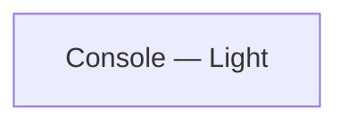

# Navigation and flows

| From | Element | To | Transition |
|---|---|---|---|
| — | — | — | — |

## Notes

<!-- weshcraft:notes:start -->
_No notes yet. Agent or human additions go here; WeshCraft keeps this block when it regenerates the file._
<!-- weshcraft:notes:end -->

<!-- weshcraft:contract
{
 "edges": [],
 "kind": "front-flows",
 "sourceHash": "d378e26074d3cd4f"
}
-->
