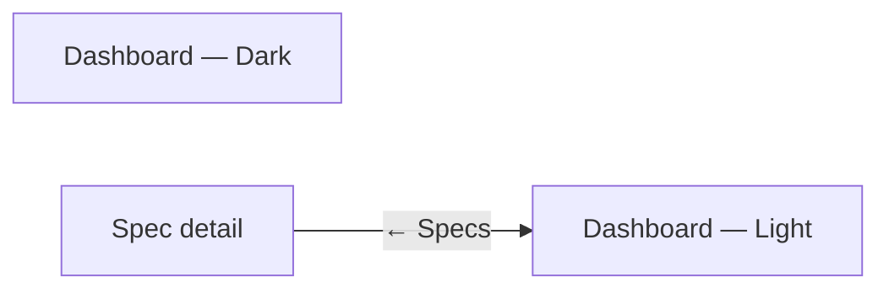

# Navigation and flows

| From | Element | To | Transition |
|---|---|---|---|
| Spec detail | `#133` ← Specs | Dashboard — Light | instant |

## Notes

<!-- weshcraft:notes:start -->
_No notes yet. Agent or human additions go here; WeshCraft keeps this block when it regenerates the file._
<!-- weshcraft:notes:end -->

<!-- weshcraft:contract
{
 "edges": [
  {
   "from": "scr-spec-detail",
   "node": 133,
   "to": "scr-dashboard-light"
  }
 ],
 "kind": "front-flows",
 "sourceHash": "d5a504f901758656"
}
-->
